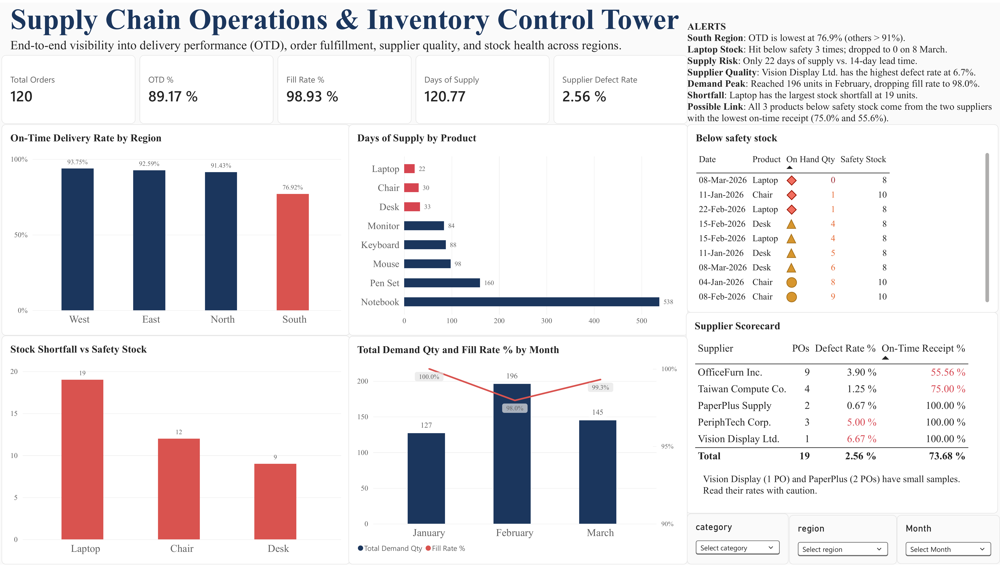

# Supply Chain Operations & Inventory Control Tower

A Power BI dashboard for supply chain analysis. It shows delivery performance, order fulfillment, inventory health, and supplier quality for Jan–Mar 2026.


> **Important:** All data in this project is **simulated**. The numbers do not come from a real company.

---

## 1. Business Questions
| Area | Question |
|---|---|
| Delivery | Do orders arrive on time? Which region is the weakest? |
| Fulfillment | Do we ship the full quantity that the customer orders? |
| Inventory | Which products are close to a stockout? Which products have too much stock? |
| Suppliers | Which suppliers have quality or delivery problems? |
| Demand | Can supply keep up when demand rises? |

---
## 2. Key Findings
| # | Finding | Evidence |
|---|---|---|
| 1 | South has the weakest delivery performance. | OTD is 76.9%. The other regions are above 91%. 6 of 26 South orders arrived late. |
| 2 | Laptop has the highest stockout risk. | Stock fell below the safety level 3 times. Stock was 0 on 8 March. |
| 3 | The Laptop stock buffer is too small. | Laptop has 22 days of supply. The supplier lead time is 14 days. |
| 4 | Laptop has the largest stock shortfall. | The total shortfall is 19 units. Chair is 12 units. Desk is 9 units. |
| 5 | Stockouts caused short shipments. | 3 Laptop orders shipped short (2 in February, 1 in March). The February fill rate fell to 98.0%. |
| 6 | Demand peaked in February. | Demand was 127 units in January, 196 in February, and 145 in March. |
| 7 | OfficeFurn Inc. has the weakest supplier delivery. | 5 of 9 purchase orders arrived on time (55.6%). |
| 8 | Some products have too much stock. | Notebook has 538 days of supply. Pen Set has 160 days. |

**Possible link (not proven):** All 3 products below safety stock (Laptop, Desk, Chair) come from the two suppliers with the lowest on-time receipt (75.0% and 55.6%). The data shows that these two facts occur together. It does not prove that one causes the other.

---

## 3. Recommendations
| Priority | Action | Reason |
|---|---|---|
| 1 | Increase the Laptop safety stock. | Laptop has 22 days of supply and a 14-day lead time. |
| 2 | Review OfficeFurn Inc. delivery performance. | OfficeFurn supplies Desk and Chair. It delivers late on 4 of 9 purchase orders. |
| 3 | Review the carrier or the warehouse for the South region. | South has the lowest OTD. |
| 4 | Reduce reorder quantities for Notebook and Pen Set. | These products tie up cash in stock. |

---

## 4. KPI Definitions
| KPI | Definition | Value |
|---|---|---|
| Total Orders | Number of distinct orders | 120 |
| OTD % | Orders delivered on or before the promised date ÷ all orders | 89.2% |
| Fill Rate % | Shipped quantity ÷ ordered quantity | 98.9% |
| Avg Lead Time | Average days from order date to delivery date | 4.3 days |
| Days of Supply | Latest on-hand stock ÷ average daily demand | 120.8 days |
| Below Safety Count | Inventory records where on-hand stock < safety stock | 9 |
| Shortfall Qty | Sum of (safety stock − on-hand stock) for records below safety stock | 40 units |
| Supplier Defect Rate | Defective units ÷ received units | 2.56% |
| Supplier On-Time Receipt % | Purchase orders received on or before the expected date ÷ all purchase orders | 73.7% |

Markdown
<details>
<summary><b>Click to view DAX formulas</b></summary>

```DAX
OTD % =
DIVIDE ( [On-Time Orders], [Total Orders] )

On-Time Orders =
CALCULATE (
    COUNTROWS ( fact_orders ),
    FILTER ( fact_orders, fact_orders[delivery_date] <= fact_orders[promised_date] )
)

Fill Rate % =
DIVIDE ( [Total Shipped Qty], [Total Demand Qty] )

On Hand Latest =
VAR LastDate = MAX ( fact_inventory[snapshot_date] )
RETURN
    CALCULATE ( SUM ( fact_inventory[on_hand_qty] ), fact_inventory[snapshot_date] = LastDate )

Days of Supply =
DIVIDE (
    [On Hand Latest],
    DIVIDE (
        [Total Demand Qty],
        CALCULATE ( DISTINCTCOUNT ( dim_date[Date] ), dim_date[Date] <= DATE ( 2026, 3, 31 ) )
    )
)

Shortfall Qty =
SUMX (
    FILTER ( fact_inventory, fact_inventory[on_hand_qty] < fact_inventory[safety_stock] ),
    fact_inventory[safety_stock] - fact_inventory[on_hand_qty]
)

Supplier On-Time Receipt % =
DIVIDE (
    CALCULATE (
        COUNTROWS ( fact_purchase_orders ),
        FILTER ( fact_purchase_orders, fact_purchase_orders[receipt_date] <= fact_purchase_orders[expected_date] )
    ),
    COUNTROWS ( fact_purchase_orders )
)
```
</details>
---

## 5. Data Model
The model is a star schema. It has 3 fact tables and 4 dimension tables.

| Table | Type | Rows | Description |
|---|---|---|---|
| `fact_orders` | Fact | 120 | Orders, promised date, ship date, delivery date, shipped quantity |
| `fact_inventory` | Fact | 104 | Weekly stock snapshots (8 products × 13 weeks) |
| `fact_purchase_orders` | Fact | 19 | Purchase orders, expected and actual receipt date, defects |
| `dim_product` | Dimension | 8 | Product, category, price, cost, safety stock, lead time, supplier |
| `dim_supplier` | Dimension | 5 | Supplier name and country |
| `dim_region` | Dimension | 4 | Region and warehouse |
| `dim_date` | Dimension | 90 | Calendar dates, 1 Jan – 31 Mar 2026 |

### Relationships (many-to-one, single direction)

| From (many) | To (one) |
|---|---|
| `fact_orders[product_id]` | `dim_product[product_id]` |
| `fact_orders[region]` | `dim_region[region]` |
| `fact_orders[order_date]` | `dim_date[Date]` |
| `fact_inventory[product_id]` | `dim_product[product_id]` |
| `fact_inventory[snapshot_date]` | `dim_date[Date]` |
| `fact_purchase_orders[product_id]` | `dim_product[product_id]` |
| `fact_purchase_orders[supplier_id]` | `dim_supplier[supplier_id]` |

---

## 6. About the Simulated Data
| Item | Description |
|---|---|
| Source | Synthetic data created with the help of an AI assistant (Claude). It is not real company data. |
| Orders | 120 orders. Order dates follow a monthly demand pattern (peak in February). |
| Inventory | The data simulates stock day by day. Shipments reduce stock. Purchase order receipts increase stock. |
| Reordering | A purchase order is created when stock reaches a reorder level. |
| Built-in patterns | South has more late deliveries. Some suppliers have more delays or defects. |

The built-in patterns are design choices. They make the analysis easier to demonstrate. They are not real-world facts.

---

## 7. Limitations
| Limitation | Effect |
|---|---|
| The data is simulated. | The findings show the method. They do not describe a real business. |
| Vision Display Ltd. has only 1 purchase order. | Its defect rate (6.67%) comes from 2 defects in 30 units. Read it with caution. PaperPlus Supply has only 2 purchase orders. |
| Inventory is a weekly snapshot. | A stockout between two snapshots is not visible. |
| Red-color thresholds are set by the author. | Defect rate ≥ 5% and on-time receipt < 80% are not industry standards. |
| The ALERTS text box is typed by hand. | It does not change when you use a slicer. It describes the full, unfiltered data. |
| Days of Supply uses average demand over 90 days. | It does not predict future demand. |

---

## 8. Tools
| Tool | Use |
|---|---|
| Power BI (web) | Data model, DAX measures, report |
| DAX | KPI measures |
| Excel | Data source (`supply_chain_data.xlsx`, 7 tables) |

---

## 9. Repository Structure
```
├── README.md
├── images/
│   └── dashboard.png
├── data/
│   └── supply_chain_data.xlsx
└── report/
    └── supply_chain_dashboard.pbix
```
